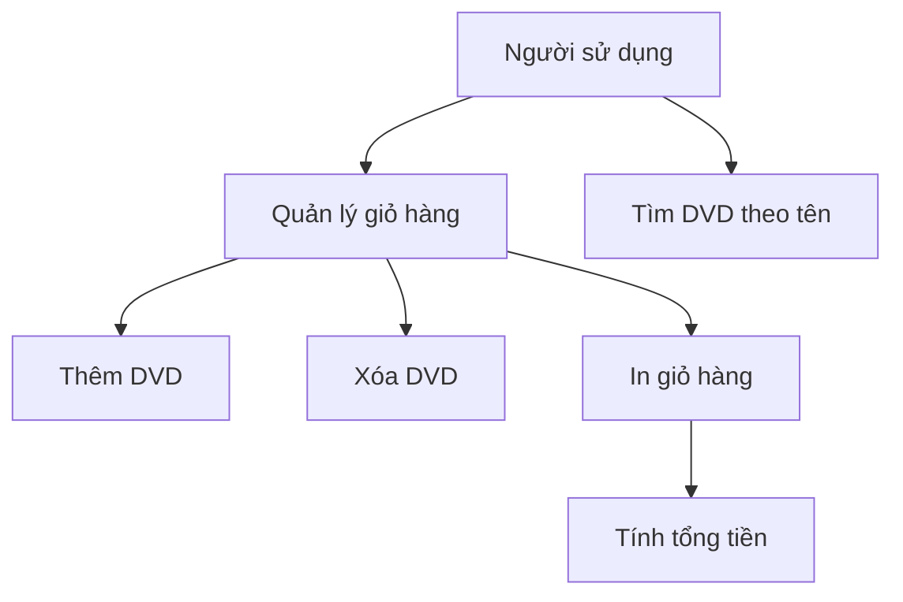

# Use case — AIMS-mini

- MSSV: 202417250
- Phạm vi: các chức năng đã triển khai đến Lab 02.

## Sơ đồ chức năng

Sơ đồ Mermaid dưới đây mô tả tác nhân và các chức năng;
đây là biểu diễn đơn giản, không phải ký pháp UML đầy đủ.

## UC01 — Thêm DVD vào giỏ

- Tác nhân: người sử dụng thông qua chương trình.
- Đầu vào: một đối tượng DigitalVideoDisc.
- Luồng chính: kiểm tra giới hạn giỏ, thêm DVD và trả về True.
- Ngoại lệ: giỏ đầy thì từ chối và trả về False.
- Yêu cầu: giỏ chứa tối đa 20 DVD.
- Ghi chú: mã hiện tại còn lỗi biên, sẽ được kiểm thử và sửa ở Lab 03.

## UC02 — Xóa DVD khỏi giỏ

- Đầu vào: DVD cần xóa.
- Nếu DVD có trong giỏ: xóa một phần tử tương ứng, trả về True.
- Nếu DVD không có trong giỏ: trả về False, giữ nguyên giỏ.

## UC03 — In giỏ hàng

- Nếu giỏ có DVD: in số thứ tự, tên, thể loại và giá từng DVD,
  sau đó in tổng tiền.
- Nếu giỏ rỗng: in "The cart is empty".
- Thao tác không làm thay đổi các phần tử trong giỏ.

## UC04 — Tính tổng tiền

- Tính tổng giá các DVD trong giỏ, làm tròn hai chữ số thập phân.
- Giỏ rỗng có tổng bằng 0.
- Dữ liệu demo có tổng 63.89 $.

## UC05 — Tìm DVD theo tên

- Đầu vào: danh sách DVD và từ khóa.
- Trả về danh sách DVD có tiêu đề chứa từ khóa.
- Không tìm thấy thì trả về danh sách rỗng.
- Không thay đổi danh sách đầu vào.
- Bản Lab 02 còn phân biệt hoa thường; Lab 05 sẽ sửa để đáp ứng
  yêu cầu tìm kiếm không phân biệt hoa thường.

## Ghi chú phạm vi

main.py hiện là chương trình minh họa bằng dữ liệu có sẵn,
chưa có menu nhập liệu tương tác. Các chức năng được cung cấp
qua phương thức của Cart và hàm search_by_title.
